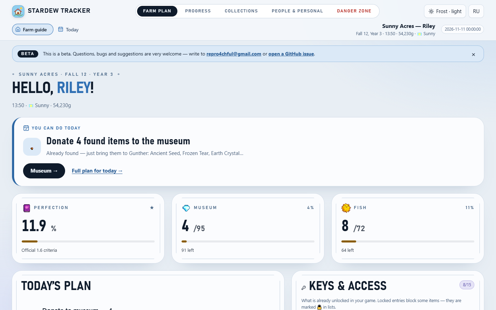
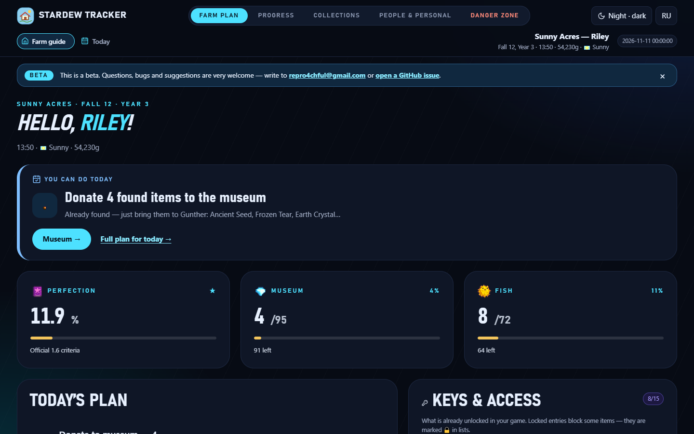

# Stardew Valley Progress Tracker

**A local, offline progress tracker for Stardew Valley 1.5 / 1.6 save files.** Point it at your save and it shows what is done and what is left: collections, museum, fish, shipping, cooking, crafting, villagers, bundles, perfection, and your own goals. No mods, no SMAPI, nothing to install but the app itself.

[](https://github.com/KyuuketsukiAkado/stardew-tracker/actions/workflows/ci.yml)
· 🌐 [Website](https://kyuuketsukiakado.github.io/stardew-tracker/)
· 🇷🇺 [Русская версия](README.ru.md)

> **Public beta — feedback wanted.** Questions, bug reports and suggestions are very welcome:
> **[repro4chful@gmail.com](mailto:repro4chful@gmail.com)** or [open a GitHub issue](https://github.com/KyuuketsukiAkado/stardew-tracker/issues/new/choose).
> The same address is shown in a small banner inside the app; you can dismiss it.

<p align="center">
  
  
</p>

## Highlights

- **Reads the save file only.** Works on the XML your game already writes — no mods, no SMAPI.
- **Private by design.** Everything runs on your computer. The app makes no network requests, and your save never leaves your machine. Links to the wiki are ordinary links that your browser opens.
- **"What can I actually get right now?"** The tracker reads which locations and quests you have already unlocked (Ginger Island, Qi's Walnut Room, Skull Cavern, the Sewers, Secret Woods, mine floors, skills, hearts…) and marks everything you cannot get yet with 🔒 and a short *How to unlock* hint.
- **Filters that match how you play.** Fish by place (for example "The Mines"), time of day, season, weather and gear; museum items by where to find them; recipes by source; everything by "available to me / needs unlocking".
- **Live updates.** The page refreshes by itself when the game writes the save. Switch between farms from the header.
- **English and Russian.** The interface and the console messages follow your system language, and you choose on first launch ([details](#languages)).
- **Light and dark themes** — *Frost* (light) and *Night* (dark), plus "match my system".
- **Spoiler-safe secrets.** A separate *Danger zone* holds Mr. Qi's quest solutions and other secrets behind a warning and a per-hint click. Nothing is revealed by accident.
- **Marks, notes and goals.** Star items, add short notes, and create goals that count their own progress.
- **Free and open source** (MIT). Python standard library only.

## Download

Ready-made apps are on the **[Releases](https://github.com/KyuuketsukiAkado/stardew-tracker/releases)** page (beta builds are marked *Pre-release*; `SHA256SUMS.txt` is next to the files).

| System | File |
|---|---|
| **Windows** | `StardewTracker-windows-v….zip` → `StardewTracker.exe` |
| macOS (Apple Silicon only) | `StardewTracker-macos-v….zip` → `StardewTracker` |
| Linux (x86-64) | `StardewTracker-linux-v….zip` → `StardewTracker` |

1. Unpack the archive and run `StardewTracker.exe` (macOS/Linux: `./StardewTracker`).
2. Your browser opens `http://127.0.0.1:8777` (the next free port if that one is busy). The tracker asks before looking in the listed Stardew Valley save folders. You can instead enter your own folder; nothing is uploaded.
3. Close the console window to stop the app. Use **Folders** in the app to withdraw permission at any time.

The apps are **not code-signed**, so your system may warn you:

- **Windows (SmartScreen):** *More info* → *Run anyway*.
- **macOS:** right-click → *Open*, or `xattr -d com.apple.quarantine StardewTracker`.
- **Linux:** `chmod +x StardewTracker` if the file is not executable.

Your goals and notes live in `%APPDATA%\StardewTracker` (Windows), `~/Library/Application Support/StardewTracker` (macOS) or `~/.local/share/StardewTracker` (Linux). Set `STARDEW_TRACKER_HOME` to move them.

> Windows build: tested by hand on real saves from 1.5.6 and 1.6.15. The macOS and Linux builds only pass an automatic smoke test in CI. The macOS build targets Apple Silicon on a recent macOS; on older systems run it from source.

## Run from source

Python 3.9+ and nothing else (no `pip install`).

```bash
python3 tracker.py serve                     # live server (default command)
python3 tracker.py info                      # what the parser found in your saves
python3 tracker.py build --save "/path/to/Saves/Farm_123/Farm_123"   # one-off report.html
python3 -m stardew_tracker --version
```

On Windows you can double-click `run.bat` (live server) or `report.bat` (standalone `report.html`). In a terminal, `info`, `build` and `open` ask before searching if interactive; scripts can use `--allow-scan` to explicitly allow and remember the search. `--save` and `--saves-dir` read only the path you specify, without granting automatic access. Useful options: `--save`, `--saves-dir`, `--allow-scan`, `--port`, `--host`, `--out`, `--no-open`, `--no-watch`, `--lang`, `--version`.

Saves are normally in `%APPDATA%\StardewValley\Saves\<Farm>_<ID>\<Farm>_<ID>`. No game save at hand? Create a synthetic one: `python3 tests/make_test_save.py /tmp/saves`.

## Languages

The tracker speaks **English** and **Russian**.

- **In the browser:** on first launch a small dialog asks which language you want (your browser's language is suggested, and "Remember my choice" is ticked). Change it any time with the **EN / RU** button in the top bar.
- **In the console and error messages:** the language of your system is used (Windows display language, or `LC_ALL` / `LANG` elsewhere); anything other than Russian falls back to English. Override it with `--lang en|ru` or the `STARDEW_TRACKER_LANG` environment variable.
- **Item names:** the English interface shows English names only; the Russian interface shows the Russian name with the English one next to it, which helps when searching the wiki.

## What is inside

- **Farm guide and Today** — date, weather, what to do today, birthdays, what can be caught right now, which bundles are one item away, and a *Keys & access* panel.
- **Perfection** — the official 1.6 perfection categories with weights, waivers, skills, obelisks and Stardrops.
- **Museum** — all 95 artifacts and minerals; items found but not yet donated are highlighted; where-to-find filter.
- **Fish** — the 72 fish of the 1.6 collection plus the five *Legendary II* fish from Mr. Qi's quest (marked separately), with place / time / season / weather / gear filters.
- **Shipping, Cooking, Crafting** — 154 shipping items, 81 dishes and 150 crafting recipes; every recipe shows its exact source (skill level, friendship, Queen of Sauce date, shop, quest, Mr. Qi…).
- **Unlock requirements** — what you already unlocked and what blocks each item (see Highlights).
- **Danger zone · Secrets** — solutions for Mr. Qi's special orders, *Mysterious Qi*, secret notes and journal scraps. Entry needs explicit confirmation, hints and solutions open separately, and sections for places you have not unlocked yet are flagged. Solutions include item icons and self-drawn diagrams; screenshots of the game are not bundled.
- **Villagers** — 34 NPCs with portraits, hearts, birthdays and gift ideas.
- **Bundles** — Community Center items, quality, progress and rewards.
- **Adventurer's Guild** — the 12 monster-slaying goals and rewards.
- **Goals** — your own goals with automatic progress, a task checklist, JSON import/export.

## Privacy and security

- The save is parsed locally. The app sends nothing anywhere: no analytics, no telemetry, no update checks.
- The server listens on `127.0.0.1` only. Access from your network needs an explicit `--host 0.0.0.0`. On loopback it also rejects foreign `Host` headers (DNS-rebinding protection) and never sends CORS permissions.
- XML containing `DOCTYPE` / `ENTITY` is rejected as unsafe.
- Danger-zone solutions are not part of the page source or the state sent by the server; the page asks for them only after you agree, and forgets them when you leave the section. (This protects against accidental spoilers; it is not a secret.)
- `goals.json` is written atomically and a `.bak` is kept. Your saves, goals and reports are git-ignored.

A detailed review is in [`docs/AUDIT.md`](docs/AUDIT.md) (in Russian).

## Feedback

This is a beta and I would love to hear from you — what works, what is confusing, what is missing, which part of your save looks wrong.

- ✉️ **[repro4chful@gmail.com](mailto:repro4chful@gmail.com)** — questions and suggestions
- 🐞 **[GitHub issues](https://github.com/KyuuketsukiAkado/stardew-tracker/issues/new/choose)** — bugs and feature requests (please say which game version your save is from and which build you use; **never attach your save publicly if you do not want to share your farm's details**)

## Known limitations

- The redesign is still in progress: the overview, *Today* and navigation are done; collection pages and the rest are being redesigned next. See the [proposed stages 2–4 roadmap](docs/REDESIGN-ROADMAP.md) and the [first-screen UX audit](docs/UX-AUDIT.md) (both in Russian).
- Multiplayer: only the host is counted.
- The perfection percentage has not been compared with the number shown by the game itself. Obelisk and Golden Clock names are not verified on real saves.
- Saves from 1.5.6 lack some data (for example tomorrow's weather); those fields stay empty.

## Development

```bash
python3 -m unittest discover -s tests -v
python3 tests/make_test_save.py /tmp/saves
python3 tracker.py info --saves-dir /tmp/saves
```

The tests use only `unittest` and a synthetic save. CI runs them on Python 3.9, 3.11 and 3.13 and checks `ruff`, formatting, `mypy`, `bandit` and coverage of at least 85 %:

```bash
python3 -m pip install -r requirements-dev.txt
ruff check .
ruff format --check stardew_tracker tracker.py tests packaging/build_app.py tools
mypy
bandit -q -r stardew_tracker tracker.py build_data.py tools
coverage run -m unittest discover -s tests && coverage report
python tools/build_demo.py --check        # docs/index.html must be up to date
```

- The landing page lives in `site/` (a template) and is built by `tools/build_site.py`; the **Pages** workflow publishes it to GitHub Pages on every push to `master`, filling in the download links of the current version. Optional check without a browser: `node tools/site_smoke.js` (needs `npm install --no-save jsdom`).
- `docs/index.html` is a standalone demo report for a fictional farm, generated by `tools/build_demo.py` (deterministic: no clock, time zone, local paths or `goals.json`). Rebuild it with `python tools/build_demo.py` after changing `assets/dashboard.html` or `data/`.
- The page is a single template, `assets/dashboard.html` (inline CSS and JavaScript). With Node.js installed, the test suite also syntax-checks its script. [`tools/ui_smoke.js`](tools/ui_smoke.js) renders every page in a headless DOM (`npm install jsdom` first) — handy for catching script errors without a browser.
- The code is a package, `stardew_tracker/` (save finder, XML parser, reference data, state, report, HTTP server, CLI, i18n). `tracker.py` is a compatibility entry point.

### Building the app yourself

```bash
python3 -m pip install -r requirements-build.txt
python3 packaging/build_app.py          # Windows: build_app.bat
```

The **Build app** workflow in GitHub Actions builds Windows, macOS and Linux binaries; pushing a `v*` tag publishes them as a release (tags with a hyphen, such as `v0.4.0-beta.2`, become pre-releases). Release notes come from `.github/release-notes/<tag>.md`.

## Data and game sprites

`data/` and the pixel atlases in `assets/sprites/` were prepared from local Stardew Valley 1.6.15 files with `build_data.py` (no dependencies). To rebuild, point it at an unpacked `Content` folder:

```bash
python3 build_data.py --content-dir "/path/to/Stardew Valley/Content (unpacked)"
```

The app does not need the game installed. Game names and graphics belong to their owner and are included only for this project's local interface.

## Credits and attribution

- Stardew Valley, its names, game data and sprites are © ConcernedApe. This is an unofficial fan project; it is not affiliated with or endorsed by ConcernedApe.
- Save fields were cross-checked against [Stardew Checkup](https://github.com/MouseyPounds/stardew-checkup); the full-shipment item list is derived from Stardew Checkup (MIT, MouseyPounds).
- Interface icons are [Lucide](https://lucide.dev) (ISC), embedded in the page.
- Project code is MIT-licensed — see [`LICENSE`](LICENSE).

## Project files

```text
tracker.py                 compatibility CLI entry point (python tracker.py ...)
stardew_tracker/           package: parser, state, report, server, CLI, i18n
build_data.py              builds the local reference data and sprite atlases
data/*.json                bilingual data for 1.6.15
assets/dashboard.html      the interface (inline CSS/JS)
assets/sprites/*.png       game pixel atlases
tests/                     tests and the synthetic save generator
docs/index.html            standalone demo (generated by tools/build_demo.py)
docs/AUDIT.md              audit, findings and QA report (Russian)
site/                      template of the landing page (GitHub Pages)
tools/                     build_demo.py, build_site.py, ui_smoke.js and site_smoke.js (optional DOM checks)
packaging/                 PyInstaller spec and the app build script
TZ.md                      detailed specification and save format notes (Russian)
```
